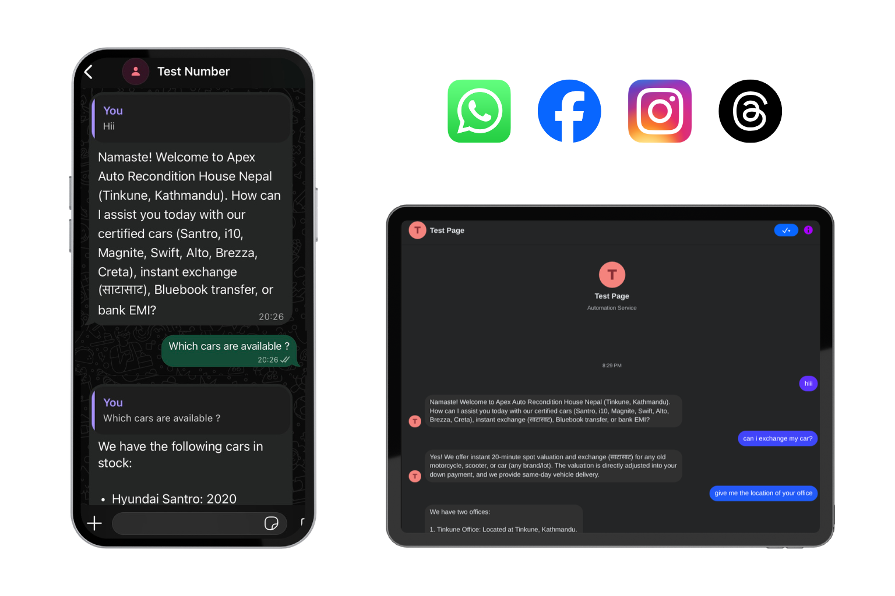
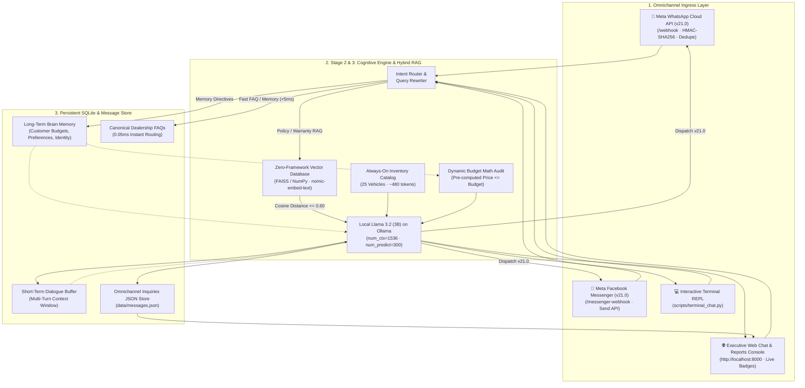

# Apex Auto Recondition Nepal — AI Customer Support & Inquiries Intelligence Engine

A production-grade, omnichannel AI customer support agent and analytics console designed specifically for **Apex Auto Recondition Nepal** (Tinkune Subidhanagar, Kathmandu & Nayabazar, Pokhara).

The system handles customer inquiries 24/7 across **Meta WhatsApp Cloud API (v21.0)**, **Facebook Messenger (v21.0)**, and the **Executive Web Chat Console**, grounded in verified Nepali car market inventory (**Hyundai Santro, Grand i10, Nissan Magnite, Maruti Alto, Swift, Brezza, Tata Tiago/Nexon, Creta**) priced strictly in **NPR Lakhs**, Bagmati Lot numbers, 2081/82 tax status, 20-minute spot exchange (साटासाट), and 24-hour Bluebook ownership transfer (नामसारी).

The entire engine runs **100% locally** on **Llama 3.2** (3B, Q4_K_M) and **nomic-embed-text** via Ollama—ensuring zero per-token cloud costs, absolute customer privacy, hardware compliance with NVIDIA RTX 3050 (4GB VRAM), and sub-5ms fast-exit routing for canonical showroom FAQs.



---

## 1. System Architecture



---

## 2. Core Capabilities & Architectural Highlights

### 🚗 Hybrid RAG & Always-On Inventory Catalog
- **Dense Vector Search Blindness Solved**: Dense embeddings (`nomic-embed-text`) measure semantic similarity rather than mathematical inequality ($P \le B$). To eliminate budget recommendation errors, all 25 certified showroom cars are maintained in an always-on compact Markdown table (~480 tokens).
- **Dynamic Pre-Audited Budget Math**: Whenever a customer's budget is recorded in SQLite or stated in conversation, Python mathematically segments inventory into:
  - `Certified cars within customer budget (Price <= B Lakhs)`
  - `Cars slightly above customer budget (+X Lakhs)`
  This guarantees 100% mathematical accuracy without brittle query keyword matching.
- **Tricky Customer Questions**: Llama 3.2 can reliably answer arbitrary queries (*"Is Grand i10 in my budget?"*, *"Can I buy a Creta with 16 lakhs?"*, *"What is its price?"*, *"Show me the cheapest automatic"*) with zero prompt leakage.

### 🧠 Stage 2 Persistent Brain Memory
- **Instant Save & Recall (<5ms)**: Automatically extracts and remembers user preferences, identity, and stated budgets across sessions.
- **Dynamic Budget Updates**: Seamlessly handles adjustments (*"I increased my budget its 20 lakhs"*), purging older budget records in SQLite to keep the latest budget active.

### ⚡ Sub-Millisecond 0ms Fast Paths & OOD Guard
- **Deterministic FAQ Anchors**: Instant responses (0 ms) for showroom address (Tinkune Subidhanagar & Pokhara Nayabazar), business hours (9:30 AM - 6:30 PM), 6-month warranty, 120-point inspection, and 20-min spot exchange (साटासाट).
- **Strict Out-of-Domain (OOD) Deflection**: Semantic cosine gate rejects any query with distance $> 0.60$, politely deflecting out-of-domain topics (cooking, football, coding, foreign visas) back to showroom inventory and services.

### 📱 Omnichannel Integration
- **Meta WhatsApp Cloud API (v21.0)**: HMAC-SHA256 signature verification, automated challenge-response, deduplication, and asynchronous reply delivery.
- **Facebook Messenger (v21.0)**: Page token authentication, webhook challenge verification, and automated messaging.
- **Modern Web Dashboard**: Real-time KPI analytics, customer leads directory, conversation transcript inspector, and live latency badges.

---

## 3. Verified Inventory & Showroom Invariants

| Category | Vehicles in Stock | Pricing (NPR Lakhs) |
|:---|:---|:---:|
| **Hatchbacks** | 2019 Maruti Alto 800, 2022 Alto K10 VXi+, 2020 Santro Magna, 2021 Santro Sportz, 2020 WagonR VXi, 2019 Grand i10 Magna, 2021 Tiago XZ+, 2020 Swift VXi, 2021 Baleno Delta, 2022 Grand i10 Nios AMT | **10.5L – 24.5L** |
| **Sedans & Compact SUVs** | 2022 Swift ZXi Dual Tone, 2021 Nissan Magnite XL Turbo, 2020 Vitara Brezza ZXi Hybrid, 2020 Tata Nexon XM, 2022 Nissan Magnite XV Premium CVT, 2021 Kia Sonet HTK+ Turbo iMT, 2021 Hyundai Venue S+ | **25.5L – 32.5L** |
| **Mid-Size SUVs & EVs** | 2020 Kia Seltos HTK+, 2021 Hyundai Creta SX Executive, 2019 Toyota Rush G Auto, 2022 Toyota Raize Z Turbo, 2023 BYD Atto 3 Superior Extended EV, 2022 Tata Nexon EV Prime, 2018 Toyota Hilux Double Cab 4x4 | **31.5L – 58.0L** |

- **Legal Ownership Transfer (नामसारी)**: 24 to 48 hours at Yatayat Ekantakuna / Gurjudhara, all 2081/82 taxes verified.
- **Exchange (साटासाट)**: Instant 20-minute spot valuation for any two-wheeler or four-wheeler, adjusted into down payment.
- **Warranty**: 6-Month engine and gearbox warranty + 1 free full servicing.

---

## 4. Quick Start Guide

### Prerequisites
- **OS**: Linux (tested on Arch Linux / Ubuntu)
- **Python**: 3.11+
- **Ollama**: Running locally with `llama3.2` (3B) and `nomic-embed-text`:
  ```bash
  ollama pull llama3.2
  ollama pull nomic-embed-text
  ollama serve
  ```

### 1. Installation
```bash
git clone https://github.com/your-username/ChatBot.git
cd ChatBot

python3 -m venv .venv
source .venv/bin/activate
pip install -r requirements.txt
```

### 2. Environment Configuration
```bash
cp .env.example .env
```
Key settings in `.env`:
```ini
LLM_URL=http://localhost:11434
LLM_MODEL=llama3.2
LLM_NUM_CTX=1536
EMBED_MODEL=nomic-embed-text
RAG_DISTANCE_THRESHOLD=0.60
PORT=8000
```

### 3. Ingest Showroom Knowledge Base
```bash
python scripts/ingest_data.py
```
Outputs 31 sentence-boundary chunks embedded with `nomic-embed-text` into `data/vector_db`.

### 4. Run Everything in One Command
```bash
./run.sh
```
This automatically boots:
1. Ollama background daemon on `http://127.0.0.1:11434`
2. FastAPI Webhook & Analytics Dashboard on `http://127.0.0.1:8000`
3. Interactive Terminal Benchmark REPL for instant testing

---

## 5. Verification & Testing

### Interactive Terminal REPL
```bash
python scripts/terminal_chat.py
```
Includes live inference timing, token counts, model badges, and memory inspection.

### Automated Multi-Turn Budget Flow Test
```bash
python scripts/test_budget_flow.py
```
Tests the 7-turn conversational flow:
1. Customer budget memory storage (16 Lakhs)
2. Budget memory recall
3. Stock recommendations strictly $\le$ 16 Lakhs (Santro Magna 15.5L, Alto K10 14.2L, Alto 800 10.5L)
4. Contextual pronoun pricing follow-up
5. Dynamic budget increase to 20 Lakhs
6. Updated recommendations (Grand i10 Magna 19.5L, Santro Sportz 17.8L, WagonR 17.5L)
7. Verification of Grand i10 within updated budget

### Full Benchmark Evaluation Suite
```bash
python scripts/run_eval.py
```
Runs all 30 evaluation test cases across showroom inventory, pricing in Lakhs, warranties, and domain deflection.

---

## 6. Project Directory Layout

```
ChatBot/
├── data/
│   ├── chat.db                        # SQLite database (memories, dialogue, deduplication)
│   ├── messages.json                  # Message logs for CRM dashboard
│   ├── vector_db/                     # Zero-framework vector database (vectors.npy, chunks.pkl)
│   └── knowledge/
│       ├── cars_inventory.csv         # 25 verified Nepali showroom vehicles
│       └── recondition_house_guide.md # Dealership policies (Exchange, Bluebook, Warranty)
├── src/
│   ├── channels/                      # Meta WhatsApp & Messenger dispatchers
│   ├── stage2_memory/
│   │   ├── catalog_service.py         # Always-on catalog & dynamic budget math audit
│   │   ├── document_loader.py         # CSV & Markdown chunking loader
│   │   ├── memory_service.py          # SQLite long-term customer memory extraction
│   │   ├── ollama_embedder.py         # Direct HTTP nomic-embed-text embedding client
│   │   ├── retriever.py               # Vector retrieval with strict cosine distance cutoff
│   │   ├── router.py                  # Intent router, fast anchors & query contextualizer
│   │   ├── session.py                 # Multi-turn dialogue FIFO buffer
│   │   └── vector_db.py               # Zero-framework NumPy / FAISS vector database
│   ├── stage3_brain/
│   │   ├── brain_engine.py            # Direct HTTP client for Ollama Llama 3.2
│   │   ├── orchestrator.py            # Unified memory & cognitive pipeline orchestrator
│   │   └── prompt_builder.py          # Grounded messages builder with anti-leakage guards
│   ├── static/                        # Dashboard frontend (HTML, CSS, JS)
│   ├── store.py                       # Message store utility
│   └── webhook_server.py              # FastAPI server (webhooks, health, reports)
├── scripts/
│   ├── ingest_data.py                 # Offline vector database indexing script
│   ├── terminal_chat.py               # Interactive CLI chat & latency benchmark tool
│   ├── test_budget_flow.py            # Multi-turn budget flow verification
│   └── run_eval.py                    # 30-case benchmark evaluation suite
├── eval.jsonl                         # Ground truth evaluation dataset
├── run.sh                             # One-click master startup script
├── requirements.txt                   # Minimal Python dependencies
└── README.md                          # Technical architecture & operational documentation
```
