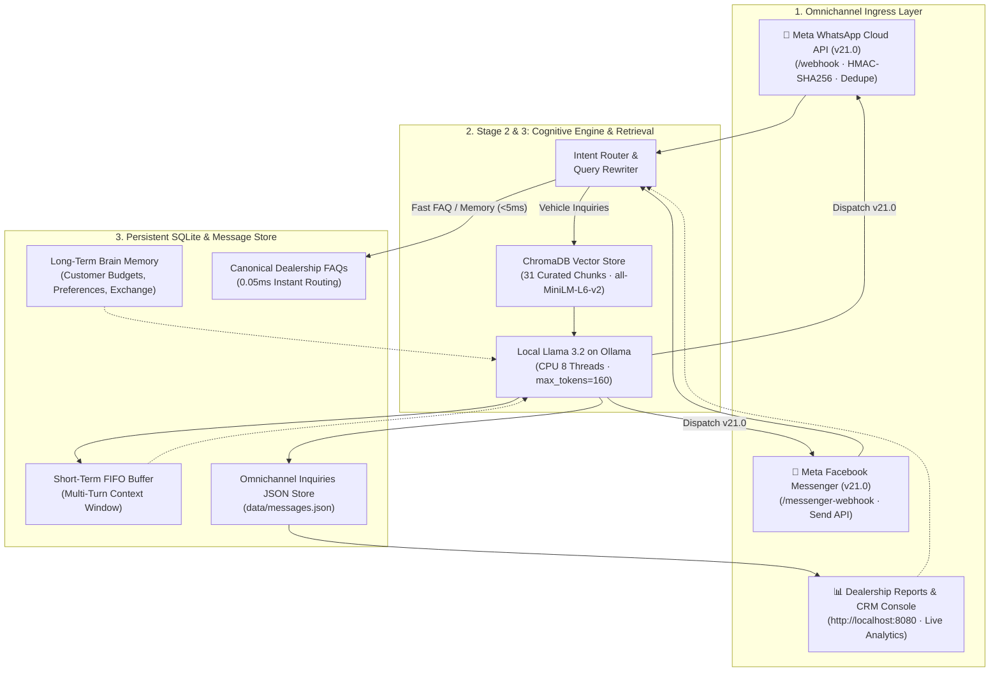

# Apex Auto Recondition Nepal — AI Customer Support & Inquiries Intelligence Engine

A production-grade, omnichannel AI customer support agent and analytics console designed specifically for **Apex Auto Recondition Nepal** (Tinkune Subidhanagar, Kathmandu & Nayabazar, Pokhara).

The system handles customer inquiries 24/7 across **Meta WhatsApp Cloud API (v21.0)** and **Facebook Messenger (v21.0)**, grounded in verified Nepali car market inventory (**Hyundai Santro, Grand i10, Nissan Magnite, Maruti Alto, Swift, Brezza, Tata Tiago/Nexon, Creta**) priced in **NPR Lakhs**, Bagmati Lot numbers, 2081/82 tax status, 20-minute spot exchange (साटासाट), and 24-hour Bluebook ownership transfer (नामसारी).

The entire system runs **100% locally** on a **Llama 3.2** model via Ollama—ensuring zero per-token cloud billing, absolute customer data privacy, and sub-5ms fast-exit routing for canonical showroom FAQs.

(https://github.com/Nishchal-ll/Omnichannel-AI-Chatbot/blob/main/chatbot.png)

---

## 1. System Architecture



---

## 2. Core Capabilities

### 🚗 Verified Nepali Automotive Knowledge Base
- **Popular Models in Stock**:
  - **Hyundai**: Santro Magna (2020, 1100cc, NPR 15.5 Lakhs), Santro Sportz (2021, NPR 17.8 Lakhs), Grand i10 Magna (2019, NPR 19.5 Lakhs), Grand i10 Nios (2022, NPR 24.5 Lakhs), Venue S+ (2021, NPR 32.5 Lakhs), Creta SX (2021, NPR 41.0 Lakhs).
  - **Nissan**: Magnite XL Turbo (2021, NPR 26.5 Lakhs), Magnite XV Premium (2022, NPR 31.0 Lakhs), Kicks XL (2019, NPR 24.5 Lakhs).
  - **Maruti Suzuki**: Alto 800 LXi (NPR 10.5 Lakhs), Alto K10 (NPR 14.2 Lakhs), WagonR VXi (NPR 17.5 Lakhs), Swift VXi/ZXi (NPR 21.0 - 25.5 Lakhs), Baleno Delta (NPR 23.5 Lakhs), Vitara Brezza (NPR 29.5 Lakhs).
  - **Tata & Kia**: Tiago XZ+ (NPR 20.0 Lakhs), Nexon XM (NPR 28.0 Lakhs), Nexon EV Prime (NPR 31.5 Lakhs), Sonet HTK+ (NPR 31.0 Lakhs), Seltos HTK (NPR 36.5 Lakhs).
  - **Toyota & Others**: Rush G (NPR 44.0 Lakhs), Raize Z (NPR 52.0 Lakhs), Hilux 4WD (NPR 58.0 Lakhs), BYD Atto 3 EV (NPR 54.0 Lakhs).
- **Showroom Services Grounding**:
  - **Bluebook Ownership Transfer (नामसारी)**: 100% legal transfer completed within 24 to 48 hours at Yatayat Karyalaya (Ekantakuna & Gurjudhara) with all 2081/82 taxes verified.
  - **Instant Vehicle Exchange (साटासाट)**: Free 20-minute technical evaluation for any old motorcycle, scooter, or car of any lot number, directly adjusted into down payment with same-day car delivery.
  - **Bank Financing & EMI**: Up to 70% financing via partner commercial banks (NIC Asia, Nabil Bank, Global IME Bank, Kumari Bank).
  - **Certification & Warranty**: 6-Month engine and gearbox warranty + 1 free full servicing with engine oil change.

### 📱 Production WhatsApp Cloud API & Facebook Messenger Webhooks
- **Meta Verification**: Automated challenge-response verification for `GET /webhook` and `GET /messenger-webhook`.
- **HMAC-SHA256 Signature Security**: Validates `X-Hub-Signature-256` using your Meta App Secret.
- **Message Deduplication**: SQLite unique index prevents duplicate processing on Meta automatic retry loops.
- **Asynchronous Background Processing**: Webhook acknowledges `200 OK` within 100ms, then generates and dispatches the AI reply asynchronously via Meta Graph API v21.0.

### 📊 Dealership Management Reports & Analytics Dashboard
- Access at **`http://localhost:8080`**:
  - **Live KPI Cards**: Total customer queries, unique leads count, WhatsApp vs Messenger distribution, top inquired models, and average AI response latency.
  - **Customer Leads Directory**: Filterable by channel (`All`, `📱 WhatsApp`, `💬 Messenger`) and search query.
  - **Full Conversation History**: Chronological view of every customer message and AI response with latency pills (`⚡ 1.2s · fast_anchor` or `⚡ 4.5s · rag_llm`).
  - **Extracted Customer Intelligence**: Displays persistent facts saved in SQLite Brain Memory (e.g., *"Budget is 20 Lakhs"*, *"Prefers Nissan Magnite"*).
  - **Inbound Simulator**: Test inquiries directly from the web console without needing external phones.

---

## 3. Getting Started

### Prerequisites
- **Python 3.11+**
- **Ollama** installed with `llama3.2`:
  ```bash
  ollama pull llama3.2
  ollama serve
  ```

### 1. Clone & Install Dependencies
```bash
git clone https://github.com/your-username/ChatBot.git
cd ChatBot

python3 -m venv .venv
source .venv/bin/activate
pip install -r requirements.txt
```

### 2. Configure Environment (`.env`)
Copy the template:
```bash
cp .env.example .env
```
Edit `.env` with your settings:
```ini
# Meta WhatsApp Cloud API (v21.0)
WHATSAPP_ACCESS_TOKEN=EAAG...
WHATSAPP_PHONE_ID=1092837465...
WHATSAPP_APP_SECRET=a1b2c3d4e5...
WHATSAPP_WEBHOOK_TOKEN=apex_recondition_webhook_secret_token

# Meta Facebook Messenger API (v21.0)
MESSENGER_PAGE_TOKEN=EAAG...
MESSENGER_APP_SECRET=a1b2c3d4e5...
MESSENGER_WEBHOOK_TOKEN=apex_recondition_webhook_secret_token

# Local Ollama Engine
LLM_URL=http://localhost:11434
LLM_MODEL=llama3.2
LLM_MAX_TOKENS=160
LLM_TIMEOUT=60

# ChromaDB Settings
COLLECTION_NAME=car_inventory_kb
OOD_DISTANCE=0.75
PORT=8080
```

### 3. Ingest Nepali Knowledge Base into ChromaDB
```bash
python scripts/ingest_data.py --force
```
Expected output:
```
• Loading Markdown: recondition_house_guide.md ↳ 6 section chunks
• Loading CSV: cars_inventory.csv ↳ 25 records
✓ Successfully indexed 31 chunks in ChromaDB ('car_inventory_kb').
```

### 4. Start Server
```bash
python src/webhook_server.py
```
Open **`http://localhost:8080`** to access the **Dealership Reports & Customer Analytics Dashboard**.

---

## 4. Meta Webhook Configuration Guide

### Configuring WhatsApp Cloud API
1. Go to [developers.facebook.com](https://developers.facebook.com/) -> Select your App -> **WhatsApp** -> **Configuration**.
2. Under **Webhook**, click **Edit**:
   - **Callback URL**: `https://<your-public-domain>/webhook` (e.g. via ngrok or VPS).
   - **Verify Token**: Must match `WHATSAPP_WEBHOOK_TOKEN` in your `.env`.
3. Under **Webhook fields**, click **Manage** and subscribe to **`messages`**.

### Configuring Facebook Messenger
1. In the Meta Developer Portal -> **Messenger** -> **Instagram / Webhooks**.
2. Click **Add Callback URL**:
   - **Callback URL**: `https://<your-public-domain>/messenger-webhook`.
   - **Verify Token**: Must match `MESSENGER_WEBHOOK_TOKEN` in your `.env`.
3. Under **Subscription Fields**, subscribe to **`messages`** and **`messaging_postbacks`**.
4. Generate a **Page Access Token** for your Facebook Page and paste it into `MESSENGER_PAGE_TOKEN` in `.env`.

---

## 5. Verification & Testing

Run the automated test suite to verify customer memory, specs Q&A, and fast routing:
```bash
python scripts/test_memory_and_chat.py
```

### Testing Inbound Messages via CLI / Dashboard
You can simulate inbound customer queries directly from the dashboard at `http://localhost:8080` or via curl:
```bash
# Simulate WhatsApp customer query
curl -s -X POST http://127.0.0.1:8080/api/channels/simulate \
  -H "Content-Type: application/json" \
  -d '{"channel": "whatsapp", "sender": "+977-9801234567", "message": "Do you have Hyundai Santro or Nissan Magnite in stock?"}'
```

---

## 6. Project Structure

```
ChatBot/
├── data/
│   ├── chat.db                        # SQLite WAL database (conversations, memories, dedupe)
│   ├── messages.json                  # Omnichannel message store for reporting
│   └── knowledge/
│       ├── cars_inventory.csv         # 25 verified Nepali cars (Santro, i10, Magnite, etc.)
│       └── recondition_house_guide.md # Dealership policies (Exchange, Bluebook, Warranty)
├── chroma_db/                         # Persistent vector store (31 indexed chunks)
├── src/
│   ├── channels/
│   │   ├── base.py                    # BaseChannel abstract class
│   │   ├── whatsapp.py                # Meta WhatsApp Cloud API v21.0 dispatcher
│   │   ├── messenger.py               # Meta Messenger Send API v21.0 dispatcher
│   │   └── registry.py                # Channel auto-registry
│   ├── stage2_memory/
│   │   ├── document_loader.py         # Multi-format CSV & Markdown loader
│   │   ├── faq_service.py             # SQLite canonical FAQ matcher (0.05ms)
│   │   ├── memory_service.py          # SQLite customer preferences extraction
│   │   ├── retriever.py               # ChromaDB vector retrieval with cosine gating
│   │   ├── router.py                  # Fast regex anchors & query contextualizer
│   │   └── session.py                 # Dialogue FIFO buffer & processed message dedupe
│   ├── stage3_brain/
│   │   ├── brain_engine.py            # Local Ollama Llama 3.2 interface
│   │   ├── orchestrator.py            # End-to-end turn orchestrator & channel dispatch
│   │   └── prompt_builder.py          # Grounded prompt builder & few-shot examples
│   ├── static/
│   │   ├── index.html                 # Dealership Reports & Analytics Dashboard
│   │   ├── app.css                    # Clean white theme styling
│   │   └── app.js                     # Real-time analytics, CRM leads & transcript viewer
│   ├── store.py                       # Message store read/write helper
│   └── webhook_server.py              # FastAPI server (webhooks, reports, simulation)
├── scripts/
│   ├── ingest_data.py                 # ChromaDB vector ingestion
│   └── test_memory_and_chat.py        # Automated end-to-end integration test
├── .env.example                       # Ready-to-use environment template
├── requirements.txt                   # Project dependencies
└── README.md                          # Documentation
```
