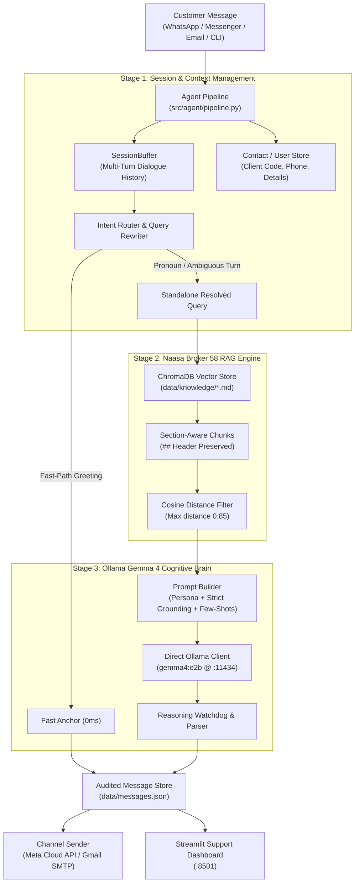

# Naasa Securities (Broker 58) AI Support Agent

An intelligent, multi-turn AI customer support agent for **Naasa Securities Co. Ltd. (Broker No. 58)** — one of Nepal's premier stock brokerage firms operating under the Nepal Stock Exchange (NEPSE) and Securities Board of Nepal (SEBON).

Powered directly by a local **Ollama Gemma 4 (`gemma4:e2b`)** model with an in-memory session buffer, pronoun query contextualizer, and section-aware **ChromaDB RAG** knowledge engine.

---

## 1. Architectural Highlights

The system follows the decoupled cognitive architecture outlined in `pipeline_analysis_and_architecture_documentation.md`:



### Key Capabilities:
- **Zero-CrewAI Direct Agent**: No bloated agent frameworks or slow wrappers. Direct, low-latency REST calls to Ollama.
- **Multi-Turn Session Memory (`SessionBuffer`)**: Preserves recent dialogue turns per customer. When a user asks *"How do I open a TMS account?"* followed by *"What documents are needed for that?"*, the rewriter resolves *"for that"* into the full context before querying vector memory.
- **Section-Aware Markdown RAG**: Markdown files are chunked by `## Section` headers, keeping each policy, fee slab, and procedure intact with its title and context.
- **Strict Out-of-Context Rejection Guard**: Queries unrelated to Naasa Securities / stock market (recipes, sports, world trivia, alien stories) are strictly deflected without hallucination.
- **Reasoning Model Support**: Tuned token watchdog (`max_tokens: 1024`) allowing `gemma4:e2b-it-qat` reasoning traces to complete cleanly without truncating the answer.
- **Automated Test Suite (`scripts/test_rag_pipeline.py`)**: End-to-end evaluation suite checking in-domain grounding, fee calculations, multi-turn resolution, contact tracking, and out-of-context guards with automated `[PASSED]` / `[FAILED]` verdicts.

---

## 2. Naasa Securities (Broker 58) Knowledge Base

All domain facts are organized under `data/knowledge/`:
1. `naasa_broker58_overview_and_contact.md`: Company profile, Lal Durbar Kathmandu head office, contact numbers (+977-1-4541243), branch network, and trading hours.
2. `naasa_broker58_account_tms_kyc.md`: Online KYC registration, mandatory documents (citizenship, photo, bank cheque, PAN), TMS 58 portal (`https://tms58.nepsetms.com.np/`), Demat & MeroShare (DP ID: 13900).
3. `naasa_broker58_trading_collateral_settlement.md`: Buy/sell order execution, ConnectIPS collateral management, NEPSE T+2 settlement cycle, MeroShare EDIS share transfer, and 20% close-out penalty prevention.
4. `naasa_broker58_brokerage_fees_charges.md`: SEBON brokerage commission slabs (0.40% down to 0.24%), 0.015% SEBON regulatory fee, DP transaction charge (Rs. 25), and Capital Gains Tax (CGT - 5% / 7.5% / 10%).
5. `naasa_broker58_faqs_troubleshooting.md`: TMS password reset procedure, collateral refund steps, NRN trading, and bank detail update workflows.

---

## 3. Directory Layout

```
ChatBot/
├── data/
│   ├── knowledge/              # Markdown knowledge base files
│   └── messages.json           # Live JSON audit trail of messages & replies
├── scripts/
│   ├── ingest_kb.py            # Ingests markdown files into ChromaDB
│   ├── test_rag_pipeline.py    # Automated 5-category evaluation test suite
│   └── test_bot.py             # Interactive CLI and one-shot test script
├── src/
│   ├── agent/                  # Core Agent Architecture (Zero CrewAI)
│   │   ├── ollama_client.py    # Direct REST client for Ollama Gemma 4
│   │   ├── pipeline.py         # Main orchestrator
│   │   ├── prompt.py           # Grounding rules, persona, few-shots
│   │   ├── router.py           # Fast anchors, out-of-context filter, query rewriter
│   │   └── session.py          # SessionBuffer and user contact tracking
│   ├── channels/               # Channel adaptors (WhatsApp, Email, Messenger)
│   ├── knowledge.py            # Section-aware chunking & ChromaDB RAG
│   ├── store.py                # Thread-safe message persistence
│   ├── streamlit_app.py        # Streamlit monitoring and testing dashboard
│   ├── webhook_server.py       # FastAPI webhook receiver on port 5001
│   └── email_poller.py         # Background Gmail IMAP polling daemon
├── .env.example                # Configuration template
├── docker-compose.yml          # Containerized deployment definition
├── requirements.txt            # Lean dependency specifications
└── start.sh                    # Unified startup script
```

---

## 4. Setup & Installation

### Prerequisites
- Python 3.11+
- [Ollama](https://ollama.com/) running locally with `gemma4:e2b` (or `gemma4:e2b-it-qat`):
  ```bash
  ollama serve
  ollama list
  ```

### Install Dependencies
```bash
pip install -r requirements.txt
```

### Configure Environment
Copy `.env.example` to `.env`:
```bash
cp .env.example .env
```
Key configuration settings:
- `LLM_URL`: Ollama endpoint (`http://localhost:11434` for local, `http://host.docker.internal:11434` inside Docker).
- `LLM_MODEL`: Model tag (default `gemma4:e2b`).
- `LLM_MAX_TOKENS`: `1024` (preserves token headroom for reasoning models).
- `WHATSAPP_ACCESS_TOKEN` / `WHATSAPP_PHONE_ID`: (Optional) Meta Cloud API credentials.
- `GMAIL_USER` / `GMAIL_APP_PASSWORD`: (Optional) Gmail credentials for email support.

---

## 5. Ingestion & Automated Verification

### Step 1: Ingest Knowledge Base
Index the Naasa Securities documents into ChromaDB:
```bash
python scripts/ingest_kb.py --force
```

### Step 2: Run the Automated Evaluation Test Suite
Execute the dedicated evaluation script to test the complete pipeline:
```bash
python scripts/test_rag_pipeline.py
```
This tests and outputs a `[PASSED]` / `[FAILED]` verdict on:
1. **In-Domain Fact Grounding**: Accurately reports Broker 58 and Lal Durbar, Kathmandu.
2. **Fee Calculation Precision**: Accurately reports the 0.40% commission rate for transactions under Rs. 50,000.
3. **Multi-Turn Pronoun Resolution**: Resolves *"for that"* into KYC document requirements without dropping context.
4. **User Contact Persistence**: Validates that client code and phone numbers are stored in session memory.
5. **Out-of-Context Rejection Guard**: Strictly deflects non-brokerage queries (e.g. chocolate cake recipes, world trivia) without hallucinating.

---

## 6. Interactive Testing & Operations

### Interactive CLI Testing
Chat with the Naasa Securities agent directly in the terminal:
```bash
python scripts/test_bot.py --interactive
```

### One-Shot Query Testing
```bash
python scripts/test_bot.py "What is the TMS portal URL for Naasa Securities?"
python scripts/test_bot.py "What happens if I forget to do EDIS?"
python scripts/test_bot.py "How do I make a chocolate cake?"
```

### Running the Full System
To start the Webhook Server (:5001), Email Poller, and Streamlit Dashboard (:8501):
```bash
bash start.sh
```
Access the dashboard at `http://localhost:8501`.

---

## 7. License & Compliance
This software is built for automated customer service for Naasa Securities Co. Ltd. (Broker No. 58) in accordance with SEBON and NEPSE trading guidelines.
