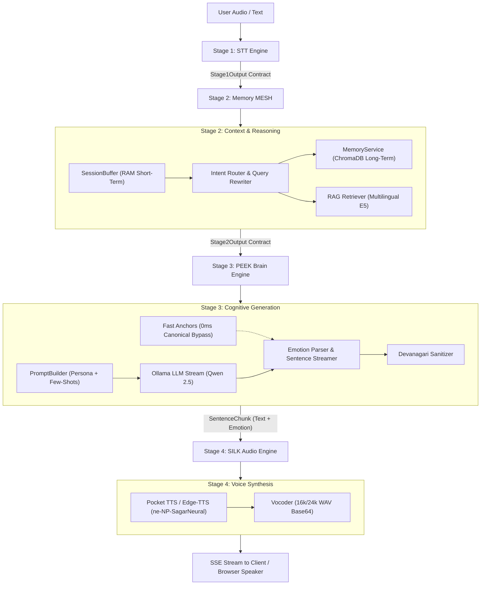

# Complete Pipeline Architecture Documentation & System Fix Plan

## 1. Executive Summary & Project Overview

The **Voice Pipeline** (`VoiceAgent-Backend` & `VoiceAgent-Web`) is an end-to-end, ultra-low-latency, multi-stage conversational AI voice agent built specifically for **Education Consultancy** (study abroad advisory for Japan, Australia, UK, USA, Canada).

The system operates across **4 decoupled pipeline stages**:
1. **Stage 1 (STT / Speech Processing)**: PyAV RAM audio ingestion $\rightarrow$ Silero VAD silence rejection $\rightarrow$ BuzzASR/Whisper/SeamlessM4T speech-to-text $\rightarrow$ Nepali text normalization, domain cleaning, and transliteration.
2. **Stage 2 (Memory MESH & Context Orchestrator)**: SessionBuffer multi-turn history $\rightarrow$ Intent & Query Router (deterministic fast paths + LLM) $\rightarrow$ Short/Long-Term Memory Deduplication (ChromaDB / MySQL) $\rightarrow$ Multilingual E5 RAG Domain Knowledge Retrieval $\rightarrow$ ContextPackage assembly.
3. **Stage 3 (PEEK Cognitive Brain)**: ContextAdapter $\rightarrow$ PromptBuilder (Persona, Response Policy, Grounding, Few-Shots) $\rightarrow$ PeekBrainEngine (Ollama / Qwen 2.5 streaming inference with token watchdog) $\rightarrow$ EmotionParser $\rightarrow$ SentenceStreamer $\rightarrow$ Devanagari TTS Sanitizer.
4. **Stage 4 (SILK Audio Output Engine)**: TTSEngine Factory (Pocket TTS `himalaya-ai/pocket-tts-nepali-6l` / Kokoro / Edge-TTS `ne-NP-SagarNeural`) $\rightarrow$ VocoderEngine $\rightarrow$ Real-time sentence audio streaming over HTTP Server-Sent Events (SSE).



---

## 2. Deep-Dive Pipeline Architecture & Methods Used

### Stage 1: Speech Processing & Audio Ingestion (`Stage1_STT`)
Located in [Stage1_STT/stt.py](file:///home/bits-lenovo/Projects/voice-pipeline/VoiceAgent-Backend/Stage1_STT/stt.py) and [Stage1_STT/processors/](file:///home/bits-lenovo/Projects/voice-pipeline/VoiceAgent-Backend/Stage1_STT/processors/).

| Method / Component | Purpose & Implementation Details | Context & Reason for Use |
| :--- | :--- | :--- |
| `load_audio(audio_input)` | Uses `av.open` (PyAV) in RAM memory with `AudioResampler` to convert WebM/OGG/WAV/MP3 blobs directly into 16kHz mono `float32` numpy arrays. | Avoids disk I/O bottlenecks during browser microphone streaming. |
| `filter_speech_silero_vad(audio)` | Evaluates raw audio tensors using the **Silero VAD** deep neural network (threshold: 0.75, min duration: 250ms, padding: 50ms). | Rejects fan hums, clicks, keyboard taps, and dead silence before running the heavy STT model. |
| `record_microphone_vad(...)` | Live microphone recording using `sounddevice` with dynamic silence endpointing (stops after 0.7s silence). | Enables hands-free, natural voice conversation in the CLI developer testbed. |
| `get_stt_model()` | Loads and caches the primary STT model (`BuzzASR/nepali` Whisper or `facebook/seamless-m4t-v2-large`) on CUDA/MPS/CPU. | Delivers high-accuracy Devanagari transcription for native spoken Nepali. |
| `resolve_stt_language(lang)` | Maps `"auto"`, `"ne"`, `"nepali"`, `"en"` to canonical ISO codes and language probabilities. | Directs downstream tokenization and language-specific post-processors. |
| `normalize_text(text)` | Normalizes unicode homoglyphs, zero-width joiners, and variations using [nepali.json](file:///home/bits-lenovo/Projects/voice-pipeline/VoiceAgent-Backend/Stage1_STT/resources/Normalization/nepali.json) (e.g. `नामास्ते` $\rightarrow$ `नमस्ते`). | Fixes colloquial acoustic variations and phonetic errors from Whisper. |
| `clean_domain_terms(text)` | Replaces fuzzy domain misspellings (e.g. `ज्यापान` $\rightarrow$ `जापान`, `बिसा` $\rightarrow$ `भिसा`). | Ensures domain terms are standardized for vector database retrieval. |
| `devanagari_to_nepglish(text)` | Rule-based phonetic Romanizer translating Devanagari characters into Roman English (Nepglish). | Supplies metadata for logs and romanized display in frontend clients. |

---

### Stage 2: Memory MESH, Routing & RAG Context (`Stage2_Memory`)
Located in [Stage2_Memory/core/memory_mesh.py](file:///home/bits-lenovo/Projects/voice-pipeline/VoiceAgent-Backend/Stage2_Memory/core/memory_mesh.py), [Stage2_Memory/routing/intent_router.py](file:///home/bits-lenovo/Projects/voice-pipeline/VoiceAgent-Backend/Stage2_Memory/routing/intent_router.py), and [Stage2_Memory/rag/retriever.py](file:///home/bits-lenovo/Projects/voice-pipeline/VoiceAgent-Backend/Stage2_Memory/rag/retriever.py).

| Method / Component | Purpose & Implementation Details | Context & Reason for Use |
| :--- | :--- | :--- |
| `SessionBuffer` | In-memory FIFO queue preserving the last $N$ dialogue turns (`user` and `assistant`) keyed by `session_id`. | Gives the LLM immediate multi-turn conversational context without database latency. |
| `IntentRouter.route(...)` | Hybrid router: Executes regex fast-paths (0.001s) for greetings, memory commands (`याद राख`), deletions (`बिर्सनुहोस्`), and out-of-domain queries, with an LLM JSON fallback. | Categorizes user intent (`information_query`, `conversational`, `personal_statement`, `memory_command`) to decide if RAG or memory lookup is needed. |
| `IntentRouter.rewrite_query(...)` | Resolves pronouns ("it", "there", "त्यो", "त्यहाँ", "how much does it cost") against prior turns into a standalone query. | Ensures ChromaDB vector similarity search queries are fully specified (e.g. "Japan tuition fees" instead of "How much does it cost?"). |
| `MemoryService` | Manages long-term user memories in **ChromaDB** (`education_consultancy_user_memory`) with deduplication threshold (0.85) and superseding (0.60). | Allows the agent to remember user preferences (e.g., target country, GPA, budget) across turns. |
| `RAGRetriever.retrieve(...)` / `query_domain_knowledge` | Encodes queries using `intfloat/multilingual-e5-large` with `query: ` prefix and performs cosine search over ChromaDB (`education_consultancy_rag`). | Grounds the agent in verified facts (visa rules, university intakes, living costs, IELTS criteria). |
| `ContextPackage` & `Stage2Output` | Strongly-typed dataclass contracts bundling `original_query`, `standalone_query`, `conversation_context`, `user_memory`, and `retrieved_knowledge`. | Strictly decouples Stage 2 memory logic from Stage 3 prompt execution. |

---

### Stage 3: PEEK Cognitive LLM Brain (`Stage3_Brain`)
Located in [Stage3_Brain/brain/brain_engine.py](file:///home/bits-lenovo/Projects/voice-pipeline/VoiceAgent-Backend/Stage3_Brain/brain/brain_engine.py), [Stage3_Brain/prompting/prompt_builder.py](file:///home/bits-lenovo/Projects/voice-pipeline/VoiceAgent-Backend/Stage3_Brain/prompting/prompt_builder.py), and [Stage3_Brain/response/](file:///home/bits-lenovo/Projects/voice-pipeline/VoiceAgent-Backend/Stage3_Brain/response/).

| Method / Component | Purpose & Implementation Details | Context & Reason for Use |
| :--- | :--- | :--- |
| `ContextAdapter` | Validates and sanitizes incoming `Stage2Output` contract payloads. | Prevents malformed dictionaries or empty strings from crashing the brain engine. |
| `PromptBuilder.build_system_prompt` | Assembles persona instructions, user memory facts, retrieved RAG knowledge, and response constraints. | Creates the contextual instructions governing tone, domain, and length (1-2 sentences max). |
| `PromptBuilder.build_messages` | Formats the final `messages` array (`system`, `user`, `assistant` turns). | Standard OpenAI/Ollama chat format. |
| `PeekBrainEngine.process(...)` | Runs streaming inference against Ollama (`qwen2.5:7b`) with a dedicated background thread and a per-token timeout watchdog queue (10s). | Prevents UI deadlocks if Ollama hangs or experiences token stalls. |
| `EmotionParser.extract_emotion` | Regex parser scanning for prefix emotion tags like `[happy]`, `[warm]`, `[thoughtful]`, `[apologetic]`, `[neutral]`. | Signals the TTS engine which vocal prosody/pitch/speed to apply. |
| `SentenceStreamer.feed(...)` | Buffer accumulating token deltas until Devanagari/English sentence terminators (`।`, `?`, `!`, `.`) are reached, then yielding chunks. | Enables sub-second audio response time by sending sentence 1 to TTS while sentence 2 is still generating. |
| `sanitize_for_tts(text)` | Strips markdown (`*`, `_`, `#`), emojis, bullet points, and applies `NEPALI_LEXICON_REPLACEMENTS`. | Protects TTS engines from pronouncing punctuation symbols or garbled text. |
| `fast_anchors.py` | Regex dictionary of standard spoken Nepali queries and canonical responses. | Intended to bypass LLM generation for common greetings and clarification requests. |

---

### Stage 4: SILK Audio Output Engine (`Stage4_TTS`)
Located in [Stage4_TTS/audio_streamer.py](file:///home/bits-lenovo/Projects/voice-pipeline/VoiceAgent-Backend/Stage4_TTS/audio_streamer.py) and [Stage4_TTS/tts_factory.py](file:///home/bits-lenovo/Projects/voice-pipeline/VoiceAgent-Backend/Stage4_TTS/tts_factory.py).

| Method / Component | Purpose & Implementation Details | Context & Reason for Use |
| :--- | :--- | :--- |
| `TTSEngine` (Abstract Base) | Defines interface: `generate_speech(text, emotion, language)` returning `(audio_array, sample_rate)`. | Allows hot-swapping different TTS engines without touching orchestrator code. |
| `PocketTTSEngine` | Implements Kyutai Pocket TTS using `himalaya-ai/pocket-tts-nepali-6l` (24kHz neural voice). | Native Nepali neural voice with high expressiveness. |
| `KokoroTTSEngine` | Language-routed engine: uses **Edge-TTS** (`ne-NP-SagarNeural` for Nepali, `en-GB-RyanNeural` for English) with Kokoro-ONNX fallback. | Highly reliable fallback delivering natural, crystal-clear spoken Nepali audio. |
| `VocoderEngine` | Encodes raw `float32` audio arrays into 16-bit PCM WAV byte streams. | Standardizes audio for browser `<audio>` playback and WebSocket streaming. |
| `AudioStreamer` | Manages sentence-by-sentence synthesis and queues chunks for background hardware playback. | Ensures seamless, zero-gap speech delivery. |

---

## 3. Comprehensive Audit: What Is Done vs. What Needs to Be Fixed

### ✅ What Is Done and Working Well
1. **Low-Latency Streaming Pipeline**: Sentence streaming from LLM to TTS operates smoothly via SSE, allowing the first audio chunk to play before full response generation finishes.
2. **Audio Decoding & VAD**: In-memory PyAV decoding and Silero VAD accurately reject room noise and silence.
3. **Intent Routing**: Deterministic fast-paths for English greetings, memory storage (`Remember that...`), and deletions work reliably.
4. **Edge-TTS Audio Quality**: When text is clean Nepali Devanagari, `ne-NP-SagarNeural` sounds authentic, clear, and natural.
5. **Session Buffer**: Short-term RAM multi-turn dialogue memory preserves recent conversation history.

---

### ❌ Critical Issues & Root Cause Analysis

#### Issue 1: `fast_anchors.py` is Completely Disconnected from the Pipeline
- **Problem**: [fast_anchors.py](file:///home/bits-lenovo/Projects/voice-pipeline/VoiceAgent-Backend/Stage3_Brain/response/fast_anchors.py) has pre-approved, authentic Nepali responses for queries like `"तिम्ले के भने तिम्ले बुझ्यो"`, `"जापान पढ्न जान कति खर्च लाग्छ"`, and `"नमस्ते"`, but `match_nepali_anchor()` is **never called anywhere in `brain_engine.py` or `stage3_pipeline.py`**!
- **Consequence**: Every single turn is sent to the LLM, causing unnecessary latency and exposing standard greetings to LLM hallucination.

#### Issue 2: RAG Knowledge Base is 100% English (Zero Devanagari Text)
- **Problem**: [education_consultancy_rag_knowledge.json](file:///home/bits-lenovo/Projects/voice-pipeline/VoiceAgent-Backend/data/education_consultancy_rag_knowledge.json) has 2,588 lines of knowledge about Australia, Japan, UK, USA, but **every single word is in English**.
- **Consequence**:
  1. Cross-lingual vector retrieval score between a short Nepali query (`जापान जान कति लाग्छ`) and English documents often falls below the 0.40 threshold.
  2. When retrieval succeeds, it injects pure English text into the prompt. Qwen 2.5 is forced to translate English facts into Devanagari on the fly, which heavily activates its Hindi/Sanskrit pre-training prior.

#### Issue 3: Attention Leak from Negative System Prompt
- **Problem**: [persona.py](file:///home/bits-lenovo/Projects/voice-pipeline/VoiceAgent-Backend/Stage3_Brain/prompting/persona.py#L96) explicitly states:
  ```text
  NEVER use Hindi or Marathi words (like बहुत, और, मै, आप, मदद, करेंगे, वेळ, रुचिमूलीक)
  ```
- **Consequence**: LLMs do not handle negation tokens well in self-attention heads. The presence of Devanagari tokens **`आप`** and **`मदद`** directly biases the model toward outputting `आपकी` and `मदद`!

#### Issue 4: Few-Shot Examples are String Dumps Instead of Chat Turns
- **Problem**: In [prompt_builder.py](file:///home/bits-lenovo/Projects/voice-pipeline/VoiceAgent-Backend/Stage3_Brain/prompting/prompt_builder.py), few-shot examples are appended as raw text inside the `system` prompt string instead of actual `{"role": "user", ...}`, `{"role": "assistant", ...}` messages.
- **Consequence**: Chat-tuned models like Qwen 2.5 treat instructions inside system text as passive descriptions, whereas in-context chat turns force strict pattern matching.

#### Issue 5: Off-by-One History Bug in `rewrite_query`
- **Problem**: In [intent_router.py](file:///home/bits-lenovo/Projects/voice-pipeline/VoiceAgent-Backend/Stage2_Memory/routing/intent_router.py#L377):
  ```python
  for turn in chat_history[:-1]:
  ```
  When `prior_history` is passed (which does not contain the current turn), `[:-1]` cuts off the **most recent prior turn**!
- **Consequence**: The query rewriter misses the immediate preceding context needed to resolve pronouns.

#### Issue 6: Gaps in Post-Generation Devanagari Sanitizer
- **Problem**: [sanitizer.py](file:///home/bits-lenovo/Projects/voice-pipeline/VoiceAgent-Backend/Stage3_Brain/response/sanitizer.py) lacks rules for words produced by Qwen:
  - `महोदय` $\rightarrow$ `साथी / तपाईं`
  - `आपकी स्वागता` $\rightarrow$ `तपाईंलाई स्वागत छ`
  - `कामलता` $\rightarrow$ `दक्षता`
  - `भएको है` $\rightarrow$ `भएको छ`
  - `गर्नुहोस् है` $\rightarrow$ `गर्नुहोस्`

---

## 4. Proposed Implementation Changes

### Component 1: Connect Fast Anchors & Few-Shot Chat Structure

#### [MODIFY] [Stage3_Brain/brain/brain_engine.py](file:///home/bits-lenovo/Projects/voice-pipeline/VoiceAgent-Backend/Stage3_Brain/brain/brain_engine.py)
- At the start of `PeekBrainEngine.process()`, check `match_nepali_anchor(stage3_input.original_query, has_rag=bool(stage3_input.retrieved_knowledge))`.
- If matched, immediately yield the canonical sentence chunk and complete in **<10ms** with 100% native Nepali fluency.

#### [MODIFY] [Stage3_Brain/prompting/prompt_builder.py](file:///home/bits-lenovo/Projects/voice-pipeline/VoiceAgent-Backend/Stage3_Brain/prompting/prompt_builder.py)
- In `build_messages()`, inject structured few-shot dialogue turns directly into the `messages` array:
  ```python
  NEPALI_FEW_SHOTS = [
      {"role": "user", "content": "नमस्ते!"},
      {"role": "assistant", "content": "[warm] नमस्ते! कन्सल्टेन्सीमा स्वागत छ। आज म तपाईंलाई विदेश अध्ययनका कुन विषयमा सहयोग गरूँ?"},
      {"role": "user", "content": "मलाई जापान भाषा स्कुल पढ्न जान मन छ"},
      {"role": "assistant", "content": "[warm] धेरै राम्रो! जापानमा भाषा स्कुल जानको लागि कम्तीमा १२ कक्षा पास र आधारभूत जापानी भाषा सिकेको हुनुपर्छ।"},
      {"role": "user", "content": "जापान जान कति खर्च लाग्छ?"},
      {"role": "assistant", "content": "[thoughtful] जापानमा भाषा स्कुल र कलेज अनुसार सुरुमा करिब १० देखि १५ लाख रुपैयाँसम्म खर्च लाग्न सक्छ।"}
  ]
  ```

#### [MODIFY] [Stage3_Brain/prompting/persona.py](file:///home/bits-lenovo/Projects/voice-pipeline/VoiceAgent-Backend/Stage3_Brain/prompting/persona.py)
- Remove negative prompt tokens (`बहुत, और, मै, आप, मदद`) from `NEPALI_PERSONA_PROMPT` to prevent attention poisoning.
- Frame rules positively: "Speak exclusively in natural, polite colloquial spoken Nepali using pronouns: तपाईं, तपाईंको, म, हामी."

---

### Component 2: Fix Multi-Turn Context & Query Rewriting

#### [MODIFY] [Stage2_Memory/routing/intent_router.py](file:///home/bits-lenovo/Projects/voice-pipeline/VoiceAgent-Backend/Stage2_Memory/routing/intent_router.py)
- Fix the history slicing bug in `rewrite_query`:
  ```diff
  - for turn in chat_history[:-1]:
  + for turn in chat_history:
  ```
- Add Devanagari intent fast-paths for follow-up questions:
  `"खर्च कति"`, `"प्रक्रिया के हो"`, `"त्यहाँको लागि"`.

---

### Component 3: Bilingual RAG Knowledge Grounding

#### [MODIFY] [data/education_consultancy_rag_knowledge.json](file:///home/bits-lenovo/Projects/voice-pipeline/VoiceAgent-Backend/data/education_consultancy_rag_knowledge.json) & Ingestion
- Add core Nepali Devanagari knowledge chunks for:
  - Japan Language School requirements (JLPT/NAT N5, 12th pass, costs 10-15 lakhs NPR).
  - Australia university bachelor/master requirements (IELTS 6.0/6.5, costs 15-25 lakhs NPR).
  - Student visa financial document requirements.
- Re-run `ingest.py` to index both English and Nepali passage vectors into ChromaDB.

---

### Component 4: Reinforce Devanagari Post-Sanitizer

#### [MODIFY] [Stage3_Brain/response/sanitizer.py](file:///home/bits-lenovo/Projects/voice-pipeline/VoiceAgent-Backend/Stage3_Brain/response/sanitizer.py)
- Expand `NEPALI_LEXICON_REPLACEMENTS` to catch remaining Hindi loan artifacts:
  ```python
  "महोदय": "",
  "आपकी स्वागता": "स्वागत छ",
  "कामलता": "दक्षता",
  "भएको है": "भएको छ",
  "गर्न सक्छु है": "गर्न सक्छु",
  "मदद": "सहयोग",
  ```

---

## 5. Verification Plan

### Automated & Unit Tests
1. **Stage 2 Intent & Rewriting**:
   ```bash
   python test_stage2_refactor.py
   ```
   Verify all 8 test cases pass without regressions.
2. **Sanitizer Unit Test**:
   Test that `sanitize_for_tts("नमस्कार, महोदय। आपकी स्वागता प्रिय भएको है। कसरी मदद गर्न सक्छु?")` correctly replaces Hindi words with native Nepali.

### Interactive CLI Verification
Run the standalone testbed:
```bash
python chat_tester.py
```
- Test 1: `"नमस्ते के छ हाल खबर"` $\rightarrow$ Expect instant warm greeting (`[happy] नमस्ते! म ठीक छु...`), 0 Hindi tokens.
- Test 2: `"मलाई जापान पढ्न जान मन छ"` $\rightarrow$ Expect accurate counseling advice with N5/costs in 1-2 sentences.
- Test 3: `"त्यहाँ जान कति खर्च लाग्छ?"` $\rightarrow$ Expect Query Rewriter to resolve `"त्यहाँ"` to `"जापान"` and return 10-15 lakhs fee guidance.
- Test 4: Audio verification with Edge-TTS (`ne-NP-SagarNeural`) speaker playback.
